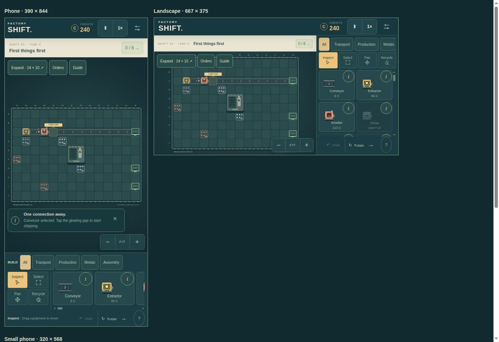

# Factory Shift v0.2 — QA

Дата: 18.10.2026.

## Виконано

- Синтаксичні перевірки чотирьох JavaScript-модулів.
- 11 тестів симуляції на Node.js, включно з проходженням усіх 8 контрактів через видобуток, переробку, маршрутизацію та продаж. Не підставлялися гроші або виконані доставки.
- 4 інтеграційні тести інтерфейсу в ізольованій імітації DOM: початковий екран, миша, вигнуті маршрути, два пальці без випадкового будування, виконання контрактів, наступна зміна, збереження/повторне завантаження, пауза, меню, звук-перемикач, SDK-ініціалізація та start/stop.
- Рендеринг реального Canvas-коду через @napi-rs/canvas: стартове поле, дві працюючі лінії, атлас машин і предметів. Зображення переглянуто.
- Перевірки рендерингу/координат при 1100×720, 821×300, 390×490, 800×270, з масштабуванням і DPR до 2.
- Перевірка standalone-пакета на самодостатність та відсутність зовнішніх ресурсів.

## Виправлено під час розробки

- Автоматичні вигнуті з’єднання конвеєрів на поворотах.
- Одна операція Undo на намальований маршрут, без дублювання матеріалів і виручки.
- Побудова відбувається після розпізнавання жесту, щоб pinch не ставив випадковий конвеєр.
- При імпорті/скиданні закривається інспектор старої фабрики.
- Повернення фокуса після вкладених меню.
- Окреме компонування для низьких мобільних екранів у горизонтальному положенні.
- Захист від пошкоджених імпортів і від перезапису несумісного старого збереження.
- При недоступному SDK показується повторне підключення, без небезпечного переходу до іншого сховища.

## Додаткова перевірка v0.1.1

Додано 10 тестів. П’ять конкретних дефектів спочатку відтворено тестами з помилкою, потім виправлено:

1. Офлайн-симуляція мала інший крок і давала іншу кількість товарів. Тепер і онлайн, і офлайн застосовують крок 50 мс. Відсутність до 5 хвилин перевірена на однакову кількість доставок.
2. Після витрати бюджету на дослідження й розбирання стартових машин гравець міг втратити джерело доходу. Стартовий комплект тепер повертається на склад і повторно розміщується без оплати.
3. Невдала побудова залишала зайвий крок Undo. Тепер відхилені й порожні дії не змінюють історію.
4. Кнопка покращення в інспекторі могла залишатися вимкненою після досягнення потрібної суми. Доступність тепер перевіряється точно за ціною.
5. Помилка читання збереження через SDK могла відкрити нову фабрику та згодом перезаписати попередній прогрес. Тепер завантаження зупиняється з повторною спробою; нового запису не відбувається.

Окремо перевірено: 8000 послідовних дій із будівництвом/розбиранням/Undo/дослідженнями без появи зайвих грошей або безкоштовних машин; міграцію старих збережень; еквівалентність виробництва при 30/60/144 Гц у тестовому циклі; одноразове нарахування заробітку після фону; відсутність заробітку при ручній паузі; роботу без доступного запису localStorage.

Фінальний прогін: 25/25 тестів успішно. Це результати симуляції та тестового DOM; вони не є вимірюванням реального FPS або браузерним QA.

## Не виконано

Повноцінний запуск у справжньому браузері та оцінка HTML/CSS-компонування, реальні жести на пристроях, прослуховування звуку, вимір FPS на бюджетному телефоні, завантаження в CrazyGames Preview, синхронізація між акаунтами/пристроями. Наявне тестове оточення не надавало дозволеного браузерного QA. Імітація DOM та SDK не замінює ці перевірки.

## Відтворення

`node --test tests/*.test.cjs` — 25 тестів, без залежностей.

`node build.cjs` — самодостатній `dist/index.html`.

`node build.cjs --crazygames` — `crazygames/index.html`, потрібен доступ до SDK у відповідному середовищі.

`tests/render-qa.cjs` — додатковий внутрішній інструмент; потребує @napi-rs/canvas у середовищі розробки. Грі ця бібліотека не потрібна.

## Перевірка v0.2

Попередні 25 тестів та 7 нових проходять. Нові перевіряють ціни/межі/ліміт розширення, виробництво на новій ділянці, точні витрати чотирьох рецептів, швидкість Express belt, міграцію старих збережень та відхилення некоректних даних землі, UI категорій/купівлю/відновлення і реальну подачу трьома конвеєрами до Robot lab. Нові тести рецептів ізолюють виробництво підготовленими входами; довготривалий баланс нових ланцюжків потребує плейтесту.

Переглянуто Canvas-атлас усіх 12 машин і 12 товарів та поле 14×22. Це перевірка Canvas у Node, не браузерний скриншот. Повна CSS-верстка, сенсорне відчуття, звук і продуктивність на реальному телефоні залишаються неперевіреними.

## Перевірка v0.3 — 18.10.2026

Всього 45 тестів: 32 попередні, адаптовані під нові правила родовищ/категорій, та 13 нових. Повний прогін 44/44; після невеликого виправлення іконок/координат та додавання перевірки UI георозвідки новий набір повторно пройшов 13/13. Унікальних перевірок — 45.

- 36 типів обладнання, 40 авторських контрактів, 39 рецептів, 8 руд.
- Для всіх 40 контрактів перевірено граф рецептів: без циклів, усі складові доступні, потрібні станки/рецепти відкриті до відповідного контракту, входів не більше трьох, кількості вміщуються в буфери.
- Усі 39 рецептів протестовано з підготовленими вхідними буферами: точне споживання, один правильний товар, одна виплата, без повторного створення з порожніх буферів. Це ізольовані тести, а не повне проходження 40 контрактів.
- Перевірено додатну маржу кожної переробки відносно продажу її інгредієнтів.
- 150 фіксованих seed × 12 ділянок: 2–3 родовища, коректні координати/межі, відновлення збереження не змінює майбутні відкриття. Окремо 400 seed × 12 ділянок: поява всіх металів, частота золота в межах 2.5–5.5% вибірки, менша за срібло; задані ймовірності Au 4%, Ag 8%.
- Георозвідка: оплата лише успішної зміни, заборона зайнятих/початкових родовищ, брак коштів, коректне збереження через UI. Реальний маршрут Extractor → Gold refinery → конвеєри → новий док.
- 10 рівнів усіх 36 типів обладнання, повне повернення витрат, заборона 11-го рівня; 20 рівнів загального живлення. Транспорт прискорюється з рівнем.
- Перемикання Alloy furnace під час роботи: спершу завершення старої партії, потім новий рецепт; закриті рецепти не обираються.
- Міграція v0.2 з трьома ділянками зберігає родовища, машини, рівні та кредити; некоректні дані землі відхиляються.
- Імітація DOM: hover/focus/info, пошук рецептів, ланцюжок складових, кампанія з 40 рядків, оплата георозвідки.
- Переглянуто Canvas-атлас усіх машин і товарів та нові ділянки з кольорами/символами металів. Масштабування й координати перевірено; розширено масштаб для поля 14×58.

Межі перевірки: тільки перші 8 контрактів автоматично проходяться зі стартового бюджету реальними лініями. Для нових 32 контрактів перевірено доступність рецептів і виробничі операції, але не повний плейтест із побудовою кожної фабрики. Не перевірено тривалий темп, фактичну складність, повну CSS-верстку в браузері, реальний сенсорний екран, відтворення звуку та продуктивність на слабкому телефоні. Навичка Sites в цьому середовищі дозволяє браузерну QA тільки через відсутню control-browser; обхідний браузер не запускався.

## v0.3.1

За побажанням користувача видалено спливний опис при наведенні/фокусі та його розмітку. Кнопки i і довідник збережено. Наявний інтеграційний тест адаптовано й виконано: наведення/фокус не відкривають опис, кнопка i відкриває його; пошук рецептів, ланцюжки та список 40 змін працюють. Це перевірка в імітації DOM, не реальному браузері.

## v0.3.2

Опис обладнання (i) закривається натисканням на фон поза вікном. Натискання всередині не закриває його. Наявний цільовий UI-тест перевіряє обидва випадки та довідник; проходить.

## v0.3.3

Видалено плашку продажів та анімацію масштабу/кольору балансу. Виконано наявні UI-smoke тести, включно з виробництвом, продажами, контрактами, паузою і збереженням. Економіка не змінювалася.

## v0.4 — 19.10.2026

Виконано 56/56 автотестів Node.js. Основний набір пройшов повністю; після фінальної зміни напрямків значків доків і перевірки натискання на лівій території повторно пройдено 11/11 тестів нового функціоналу та Canvas-перевірку.

- Змішані покупки left / right / down: ціна, нові межі, доки, незмінні координати старих станків, збереження й наступний результат RNG.
- Industrial — 2 родовища, Mining — 4, Abandoned — 2 та 4 завали. 70 seed × 3 напрямки перевірено на зв'язність доступного простору; завали не займають родовища чи док.
- Реальна виплавка й доставка в лівий док, будівництво/покращення/повернення/Undo у від'ємних координатах, георозвідка лівих родовищ.
- Старе збереження v0.3.3 із 12 ділянками та 200000 C перенесено без втрати станків, поточного виробничого процесу, родовищ, рівнів, коштів і RNG. Після перенесення доступна покупка зліва.
- Додаткові замовлення: підрахунок лише після прийняття, одночасне зарахування основному контракту, збереження, скасування, нові пропозиції, одноразова нагорода. Пропозиції перевірені на доступні рецепти протягом усіх 40 змін; у вибірці зустрілися всі 39 рецептів. Відкриття дошки не змінює геологічний RNG.
- Повна ціна до заповнення кількості замовлення, 20% після; точність кредитів до сотих. Офлайн-розрахунок відповідає такому самому часу активної симуляції; самостійно нагороди не отримує.
- Перші 8 основних контрактів виконано автоматичними маршрутами з реально заробленими коштами, без підміни бюджету. Час без затримки на ручне планування: 25, 35, 45, 50, 59, 46, 73, 64 секунд. Це перевірка прохідності початку, не оцінка часу людського проходження.
- Максимальна базова швидкість звичайного станка ×2.32; конвеєра ×2.72. Перший апгрейд видобувача залишається 63 C; ціни наступних зростають.
- Контрольний маршрут початкової залізної лінії, 600 секунд симуляції, стадія 39 (залізо — надлишок): v0.3.3 база 252 злитки / 1008 C; v0.4 база 252 / 201.6 C; v0.3.3 максимум 1997 / 7988 C; v0.4 максимум 542 / 433.6 C. Стару симуляцію взято зі знімка коду перед змінами; жодних нагород чи додаткових замовлень у цьому порівнянні.
- DOM-імітація: вибір напрямку/типу землі, купівля, натискання на клітинку зліва, відновлення, вибір і отримання нагороди додаткового замовлення. Перевірено відсутність наведення-підказок, закриття i поза вікном та колишні регресії збережень.
- Реальний Canvas відрендерено через @napi-rs/canvas на настільних і телефонних розмірах; переглянуто растрові знімки змішаного поля зліва/справа/знизу. Координати після FIT, zoom та focus перевірені. Це не знімки браузерної сторінки.

Межі перевірки: інструкція Sites для цього середовища вимагає пропустити браузерну QA, коли control-browser недоступний. Тому браузерний прогін, фактичний CSS-layout нових вікон на пристроях, CrazyGames Preview та тривале балансування пізньої кампанії залишаються неперевіреними. Публікації не було. Електростанції, рідкісні знахідки й модулі не додавалися.

## v0.4.1 — 19.10.2026

Повернено повну ціну всім товарам; попередні результати v0.4 щодо знижки 80% більше не описують актуальну економіку. Швидкість тепер 100% + 10 п.п. за придбане покращення, десять покращень від базового рівня 0 до рівня 10. Максимум 200%, включно з дослідженням і бонусом преса. Express belt має власну базову швидкість ×2. На стелі кнопка індивідуального покращення заблокована. Старі оплачені покращення, ціна повернення та баланс збережені.

Перевірки: 61 автотест, з них 5 нових. Нові тести використовують справжній генератор початку; старі маршрутні регресії використовують явну історичну карту через helpers/legacy-sim.cjs. Перевірено кожну сходинку 100%→200% за фактичним прогресом виробництва; спільну стелю дослідження; повні ціни всіх товарів до й після замовлень; міграцію v0.4 із 200000 C та старими покращеннями; два New factory через UI і правильні написи рівнів/швидкостей. 500 фіксованих seed дали 500 різних початкових карт, усі 8 металів у вибірці, рідше золото, ніж срібло. У кожній карті є 2 залізних і 2 мідних родовища та 2 випадкових, без доків, перешкод і перекриття навчальної лінії. Усі 500 карт проходять перший контракт із початковим бюджетом. Перезавантаження зберігає родовища й RNG. Перші 8 контрактів перевірені на історичній карті; повне проходження 40 змін на всіх випадкових картах не проводилося. Обмеження браузерної QA, описані вище, залишаються.

## v0.4.2 — 21.10.2026

61 попередній тест пройшов після адаптації очікувань нових ділянок, ще 2 нові тести пройшли окремо (разом 63). Перевірено: заборону купівлі справа без витрат і зміни RNG; 12 почергових розширень зліва/знизу з усіма трьома типами землі без жодного нового доку; збереження/відновлення цих карт; відсутність кнопки Right в інтерфейсі. Новий маршрут із розширеної ділянки доставляє золото до початкового правого доку. Старі приймачі та ділянки збережень залишаються сумісними. Окремо відрендерено й переглянуто справжній Canvas зі звичайними та експрес-конвеєрами в чотирьох напрямках на паузі: експреси мають подвійні бірюзові стрілки та відмінну облямівку. Повної браузерної перевірки не проводилося.

## v0.4.3 — 21.10.2026

Пройдено 13 цільових тестів: 3 нові та 10 регресій збереження/симуляції. У репозиторії тепер 66 тестів. Нові перевірки покривають стартове нагадування, таймер автозбереження через 10 секунд активної гри, ручний Save now, збереження актуального виробництва в beforeunload і pagehide, запит підтвердження лише після початку гри, повідомлення про помилку при недоступному сховищі. Події перевірялися в DOM-імітації; реальне системне вікно браузера не перевірялося. Стандартний beforeunload має обмеження активації та мобільних браузерів; власний текст вікна встановити не можна. Документація: https://developer.mozilla.org/en-US/docs/Web/API/Window/beforeunload_event . Часте автозбереження, visibilitychange і pagehide залишаються основним способом захисту прогресу.

## v0.4.4 — 21.10.2026

Пройдено всі 68 автотестів. Перевірено масштабування Mining 56→4, 200→14, 224→16; Industrial 224→8. Кількість з попереднього перегляду збігається з реально створеними родовищами, збереження й RNG відновлюються. Історичні ділянки з фіксованими 2/4 родовищами залишаються сумісними без зміни розміщеного обладнання; наступні покупки використовують нову густоту. Інші правила — ціни, типи руд, приймачі та перешкоди — не змінювалися.

## v0.4.5 — 21.10.2026

Пройшли 68 адаптованих попередніх тестів і 3 нові (71 загалом). Power та дослідження загальної швидкості вилучені з доступних правил/інтерфейсу. Швидкість 100% + 10 п.п. на індивідуальне покращення, максимум 200%; кількість інших станків, старі дослідження, старі модифікатори преса/живлення її не змінюють. Нові тести перевіряють фактичний прогрес видобувача на всіх 11 станах (0–10 покращень) при великій кількості інших машин; старе збереження із speedLevel=20 показує 100% при 0/10 та 110% після першого апгрейду; відсутні Power та кнопки досліджень. Повний список цін екстрактора та множник 1.5 для всіх видів обладнання перевірені. Старі витрати на станки залишаються в paid та повертаються при демонтажі; поточний баланс не змінюється при міграції. Перші 8 контрактів залишаються прохідними без витрат на Power. Повний браузерний прогін не проводився.

## v0.4.5 — 21.10.2026

Пройшли 68 адаптованих попередніх тестів і 3 нові (71 загалом). Power та загальні дослідження прибрано. Перевірено фактичну швидкість на кожному рівні 0–10 у великій фабриці, незалежність від старих досліджень і модифікаторів, відображення 100% замість 160% у старому збереженні та 110% після апгрейду. Перевірено список цін екстрактора й множник 1.5 для всього обладнання, повернення фактично сплачених старих витрат, збереження балансу. Перші 8 контрактів прохідні без Power. Повний браузерний прогін не проводився.

### v0.4.6
71 automated tests passed. Reload restores an already started factory without intro; production and autosave resume without a Start click. DOM harness only, not a real browser check.

## v0.5.0 — 23.10.2026

79/79 автоматизованих тестів успішні. Додано 8 тестів групового редагування: атомарне перенесення (з перекриттям власних початкових клітинок), блокування зайнятих клітинок/доків/декору/меж, вимога родовища для екстрактора, збереження інвентарю/рівнів/витрат, одна операція Undo, загальна ціна прокачування й ліміт 200%, повернення сплаченого без повторних виплат, підтвердження та скасування утилізації, рамка/Shift-клік/контекстне меню, touch-вибір/перенесення/скасування при pinch, колесо з обмеженням частоти повороту, відновлення збереження після перенесення. Сценарії жестів автоматизовані в DOM-імітації; це не тест фізичного сенсорного екрана.

Додатково виконано живу перевірку в хмарному Chrome через локальний preview: запуск гри, Shift-вибір двох об'єктів, права кнопка й меню групи, перенесення, відкриття й скасування підтвердження утилізації. Компонування оглянуто у браузерних iframe 320×568, 390×844 та 667×375. У всіх трьох розмірах scrollWidth/scrollHeight кореневого документа дорівнюють розмірам iframe; зовнішнього переповнення немає. Висота ігрового поля: 259px на 320×568, 283px на 667×375. Горизонтальний магазин прокручується окремо від карти; у landscape використовується вертикальна сітка обладнання праворуч.

Не перевірено фізичні iOS/Android пристрої, мобільну клавіатуру/панелі браузера, реальну частоту кадрів на бюджетних телефонах або CrazyGames Preview. Підтвердження відсутності будь-яких помилок на всіх пристроях не надається.

## v0.5.1 — 24.10.2026

Перетягування фону за межами карти пересуває камеру з будь-яким активним інструментом, зокрема без попереднього збільшення. Рамка виділення починається лише всередині карти. Пересування камери під час Move не розміщує групу. Додано регресійний тест для Inspect, Select, Recycle, будівництва та перенесення групи.
